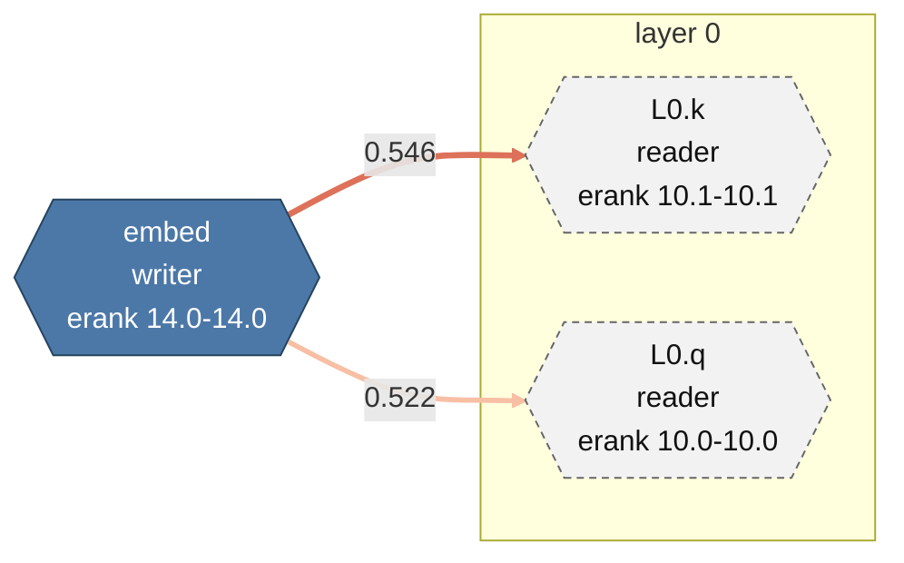

# `surgeon graph` : graphe spectral des écritures et lectures du flux résiduel

Ce document décrit ce que fait `surgeon graph`, les formules exactes implémentées, le
schéma de `graph.json`, les formats de sortie, le cache et les limites connues. Le code de
référence est `src/graph/` ; les briques réutilisées sont citées au fil du texte.

## 1. Principe

Un modèle de transformeur ajoute des directions au flux résiduel (les *écritures*) et en
lit plus tard d'autres directions (les *lectures*). `surgeon graph` approxime chaque
matrice concernée par un sous-espace de rang `r`, puis mesure l'alignement entre chaque
écriture et chaque lecture **postérieure** dans l'ordre causal du modèle. Le résultat est
un graphe orienté et pondéré, exportable en JSON, DOT, Mermaid et CSV.

Le graphe est structurel : il ne fait aucun passage avant, n'utilise ni activation ni
prompt, et ne dépend que des poids, du rang demandé et de la graine. Deux exécutions avec
les mêmes arguments produisent des octets identiques, quel que soit le nombre de fils.

### 1.1 Nœuds

| Rôle | Sens | Tenseur(s) | Base |
| --- | --- | --- | --- |
| `embed` | écrivain | `embed_tokens.weight` / `token_embd.weight` | vecteurs singuliers droits `V` (les lignes sont des directions du flux) |
| `attn_out` | écrivain | `o_proj.weight` / `attn_output.weight` | vecteurs singuliers gauches `U`, transposés (les colonnes sont des directions du flux) |
| `mlp_out` | écrivain | `down_proj.weight` / `ffn_down.weight` | idem `attn_out` |
| `q`, `k`, `v` | lecteur | `q_proj`, `k_proj`, `v_proj` / `attn_q`, `attn_k`, `attn_v` | vecteurs singuliers droits `V` (les lignes lisent le flux) |
| `gate`, `up` | lecteur | `gate_proj`, `up_proj` / `ffn_gate`, `ffn_up` | idem |
| `lm_head` | lecteur | `lm_head.weight` / `output.weight` | idem |

Les noms sont résolus par `arch::resolve` (rôles de `ArchSpec`) complétés par des motifs
de suffixe locaux, car `ArchSpec` ne décrit pas encore `q/k/v/lm_head`. Un `lm_head`
absent alors que les embeddings sont liés est synthétisé depuis
`embed_tokens`/`token_embd` et signalé dans `model.tied_lm_head`.

Un tenseur MoE fusionné `[experts, out, in]` est découpé en un nœud par expert
(`L3.gate.e0`, `L3.mlp_out.e1`, ...). Le routeur (`gate_inp`, `router`) est exclu : il ne
lit pas de direction résiduelle, il est reporté dans `model.skipped`.

### 1.2 Ordre causal

`seq` est l'instant structurel du nœud :

| Nœud | `seq` |
| --- | --- |
| `embed` | `0` |
| `q`, `k`, `v` de la couche `L` | `4L + 1` |
| `attn_out` de la couche `L` | `4L + 2` |
| `gate`, `up` de la couche `L` | `4L + 3` |
| `mlp_out` de la couche `L` | `4L + 4` |
| `lm_head` | `4 * layers + 1` |

Pour une architecture à blocs parallèles (`spec.parallel_block`, par exemple GPT-J), les
lectures `gate`/`up` partagent l'instant de `q/k/v` (`4L + 1`) et `mlp_out` celui de
`attn_out` (`4L + 2`). Une arête normale n'existe que si `source_seq < target_seq` : une
écriture ne peut pas influencer une lecture déjà exécutée.

Les arêtes structurelles MoE vont de `gate`/`up` de l'expert `e` vers `mlp_out` du même
expert `e`. Elles n'ont ni alignement ni poids spectral (`structural: true`) et sont
toujours émises, indépendamment de `--edges` et de `--min-alignment`.

## 2. Métriques spectrales et bornes certifiées

Chaque matrice `A` (de taille `m x n`) est lue en flux par `NodeSource` puis décomposée
par le SVD randomisé partagé (`surgery::rsvd`) : `k = r + oversample` colonnes, `p =
--power-iters` itérations de puissance, graine explicite. Les facteurs sont normalisés en
signe ; les sommes sont faites dans l'ordre des indices, ce qui rend le résultat
indépendant du nombre de fils.

Le SVD fournit aussi deux quantités **exactes** calculées pendant le balayage :

- `||A||_F^2`, somme des carrés de toutes les entrées ;
- `rho = ||Q^T A||_F^2 / ||A||_F^2`, l'énergie capturée par la plage randomisée `Q`.

On note `tau = 1 - rho` l'énergie de queue non capturée et
`||A||_F sqrt(tau)` sa norme. Toutes les bornes ci-dessous en découlent, sans supposer
que les valeurs singulières randomisées soient exactes.

### 2.1 Énergie et erreur

- `energy = sum_{i<=r} sigma_i^2 / ||A||_F^2`
- `residual_energy = 1 - energy`
- `range_energy = rho`
- `rel_error = ||A - U_r S_r V_r^T||_F / ||A||_F`
- `singular_values` : les `r` valeurs singulières estimées, triées.

### 2.2 `sigma1` certifié

La plus grande valeur singulière estimée `s1` est une borne inférieure (les valeurs de
Ritz d'une plage orthonormale ne dépassent pas `sigma1(A)`), et la queue majore le reste :

- `sigma1 = s1`, `sigma1_lower = s1`
- `sigma1_upper = s1 + ||A||_F sqrt(tau)`

Avec un spectre complet exact, les trois champs sont égaux à la valeur exacte.

### 2.3 Rang stable `D_spec`

`D_spec = ||A||_F^2 / sigma1^2` (stable rank). L'intervalle certifié est :

- `d_spec_lower = ||A||_F^2 / sigma1_upper^2`
- `d_spec = d_spec_upper = ||A||_F^2 / s1^2`

### 2.4 Rang effectif par entropie d'énergie

Soit `p_i = sigma_i^2 / sum_{j<=r} sigma_j^2` sur le spectre capturé, `H = -sum p_i ln p_i`,
`e = energy`, `t = 1 - e`, `d = min(m,n) - r`. La contribution du spectre capturé,
renormalisée, vaut `H_c = e H - e ln e`. Les deux extrêmes demandés sont :

- queue **packée** en une seule masse : `H_lower = H_c - t ln t`
- queue **étalée** uniformément sur `d` directions : `H_upper = H_lower + t ln d`

puis `erank_energy_lower = exp(H_lower)`, `erank_energy_upper = exp(H_upper)`, bornés
dans `[0, min(m,n)]`. Si `d = 0` ou `t = 0`, les deux bornes coïncident. Avec un spectre
complet exact (`full_spectrum: true`), la borne vaut `exp(H)` du spectre entier.

Le rang effectif L1, `erank_l1 = exp(H(sigma / ||sigma||_1))`, n'est calculé qu'en mode
spectre complet : il n'a pas de borne certifiée à partir d'un spectre tronqué, donc il
vaut `null` sinon. Le mode spectre complet est actif si
`min(m,n) <= --full-spectrum-max-dim`, `min(m,n) <= 1024` (limite de `linalg::gram`) et
`m*n <= 4_000_000` (limite mémoire du chemin exact) ; sinon un avertissement est ajouté.

## 3. Alignement écriture → lecture

Soient `B_w` (`r_w x hidden`) et `B_r` (`r_r x hidden`) les bases orthonormales du nœud
écrivain et du nœud lecteur, et `r = min(r_w, r_r)`. On forme
`C = B_w[:r] B_r[:r]^T` (`r x r`).

| Champ | Formule | Lecture |
| --- | --- | --- |
| `alignment` | `||C||_F^2 / r` | recouvrement moyen des deux sous-espaces, dans `[0, 1]` |
| `chance` | `r / hidden` | alignement attendu de deux sous-espaces indépendants |
| `alignment_norm` | `(alignment - chance) / (1 - chance)` | au-dessus de 0 : plus aligné que le hasard ; sous 0 : moins |
| `coupling` | `hidden * sum_{i,j} e_i^w e_j^r C_ij^2` | recouvrement pondéré par l'énergie ; 1 = niveau du hasard |
| `cos_theta` | `sigma_max(C)` | cosinus du plus petit angle principal, dans `[0, 1]` |

Les poids d'énergie sont `e_i = sigma_i^2 / sum_j sigma_j^2` du nœud. `coupling` est
borné à `hidden`. `sigma_max(C)` est estimé par 16 itérations de puissance déterministes
sur `C^T C` (vecteur initial uniforme), ce qui évite une SVD complète de la petite
matrice `C` et reste reproductible.

`--edge-weight alignment` (défaut) utilise `alignment` comme `weight` ; `coupling` utilise
`coupling`. Les autres champs restent présents dans `graph.json` et `edges.csv`.

## 4. Statistiques par canal

Les moments (moyenne, `M2`, `M3`, `M4`) sont calculés en **une passe** par la mise à jour
de Pébay, dans l'ordre ligne-major. Le kurtosis reporté est le kurtosis de population
`n M4 / M2^2` (loi normale : 3) ; `kurtosis_excess = kurtosis - 3`. Le calcul ne dépend
pas du nombre de fils.

L'axe des canaux est toujours l'axe résiduel : les colonnes pour `embed` et les lecteurs,
les lignes pour `attn_out` et `mlp_out`. Pour chaque canal :

- norme L2, médiane et maximum (`channels.norm_median`, `norm_max`, `norm_argmax`) ;
- kurtosis sur les valeurs du canal (`channels.kurtosis_max`) ;
- `channels.outliers` : canaux dont le kurtosis dépasse `--kurtosis-threshold`
  (défaut 10).

`global.outlier_channels` est l'union triée de ces indices sur tous les nœuds. Un nœud est
marqué outlier (octogone en DOT, classe `outlier` en Mermaid) si son kurtosis global
dépasse le seuil ou si un de ses canaux est outlier. Les valeurs non finies (NaN, infini)
sont comptées par `non_finite` puis remplacées par zéro avant le SVD et les statistiques.

## 5. `--vector` : énergie écrite et lue

`--vector` lit un vecteur de taille `hidden` (JSON `[f32]` ou fichier brut `.bin` de
`4 * hidden` octets, little-endian). Pour un écrivain,
`e_write = ||B_w v||^2 / ||v||^2` ; pour un lecteur,
`e_read = ||B_r v||^2 / ||v||^2`. C'est la fraction de l'énergie du vecteur capturée par
le sous-espace du nœud, dans `[0, 1]`. Les champs valent `null` sans `--vector`, et
`e_write`/`e_read` sont mutuellement exclusifs selon le type de nœud.

## 6. Sélection des arêtes

Pour chaque paire écrivain → lecteur strictement causale, la similarité est calculée. Sont
ensuite conservées :

- `--edges adjacent` (défaut) : depuis `embed`, toutes les lectures de la couche 0 ;
  depuis un écrivain de la couche `L`, les lecteurs postérieurs de la même couche et tous
  les lecteurs de la couche `L+1` ; depuis un écrivain de la dernière couche, `lm_head`.
- `--edges all` : toutes les paires causales.
- `--edges topk:N` : toutes les arêtes adjacentes, plus les `N` paires non adjacentes les
  plus fortes de chaque écrivain (triées par `weight`, puis par noms pour départager).
- `--min-alignment X` : filtre les arêtes dont `alignment < X` (aucune arête si `X > 1`).
  Le filtre s'applique avant `topk` et ne touche pas aux arêtes structurelles.

Les arêtes sont triées par `(source_seq, target_seq, source, target)`, donc l'ordre est
stable et reproductible.

## 7. Sorties

`--format` accepte une liste séparée par des virgules parmi `json`, `dot`, `mmd`, `csv`,
`html`, `ndjson` (défaut `json` ; un format répété n'est écrit qu'une fois). Sans `--out-dir`, rien n'est écrit : l'enveloppe ne contient qu'une
synthèse bornée (200 nœuds, 20 arêtes les plus fortes). Avec `--out-dir`, les fichiers
sont créés dans ce dossier :

| Fichier | Contenu |
| --- | --- |
| `graph.json` | rapport complet, schéma `surgeon schema --kind graph` |
| `graph.dot` | Graphviz : un cluster par couche, légende, taille de nœud logarithmique, octogones outliers, arêtes RGBA colorées |
| `graph.mmd` | Mermaid `flowchart LR` : nœuds hexagonaux, `classDef`, un `linkStyle` par arête |
| `matrices.csv` | une ligne par nœud, toutes les métriques |
| `edges.csv` | une ligne par arête, tous les champs d'alignement |
| `index.html` | vue 3D interactive autonome (section 7.3) |
| `graph.ndjson` | flux `GraphPatch` : snapshot, puis l'update vers le modèle avec `--baseline` (section 7.7) |

Les écritures sont sûres : le dossier cible est créé, chaque fichier est écrit dans un
temporaire exclusif puis renommé ; un lien symbolique ou un fichier existant est refusé
sans `--overwrite`.

### 7.1 `graph.json`

Le schéma est généré depuis `GraphReport` (`src/graph/output.rs`) et imprimé par
`surgeon schema --kind graph`. Champs de premier niveau :

- `schema_version` (1), `tool` (`name`, `version`) ;
- `model` : `path`, `sha256` (SHA-256 du modèle complet, ou `fast-...` avec
  `--fast-hash`), `hash_mode` (`sha256` ou `fast`), `format`, `architecture`,
  `arch_source`, `hidden`, `layers`, `tied_lm_head`, `tensor_count` (nombre de nœuds
  retenus), `total_weight_bytes` (somme des tenseurs uniques du graphe), `skipped`,
  `warnings` ;
- `parameters` : `rank`, `oversample`, `power_iters`, `seed`, `full_spectrum_max_dim`,
  `edge_mode`, `min_alignment`, `edge_weight`, `vector`, `kurtosis_threshold`,
  `color_scale`, `palette`, `max_nodes`, `formats` ;
- `global` : `nodes`, `edges`, `structural_edges`, `layers`, `hidden`,
  `outlier_channels`, `kurtosis_median`, `kurtosis_max`, `mean_erank_energy_lower`,
  `mean_erank_energy_upper`, `full_spectrum_nodes`, `non_finite_values`, `warnings` ;
- `nodes[]` : `id`, `role`, `kind` (`writer`/`reader`), `layer`, `expert`, `tensor`,
  `dtype`, `weight_bytes`, `rows`, `cols`, `seq`, `metrics`, `pos_column`,
  `pos_constellation` (positions 3D précalculées, section 7.6) ;
- `edges[]` : `source`, `target`, `writer_role`, `reader_role`, `source_seq`,
  `target_seq`, `layer_gap`, `rank_used`, `alignment`, `chance`, `alignment_norm`,
  `coupling`, `cos_theta`, `weight`, `structural` ;
- `baseline_diff` (avec `--baseline` seulement, section 7.4).

`metrics` contient `rows`, `cols`, `rank`, `frobenius_norm`, `energy`,
`residual_energy`, `range_energy`, `rel_error`, `sigma1`, `sigma1_lower`,
`sigma1_upper`, `d_spec`, `d_spec_lower`, `d_spec_upper`, `erank_energy_lower`,
`erank_energy_upper`, `erank_l1`, `full_spectrum`, `kurtosis`, `kurtosis_excess`,
`channels` (`count`, `norm_median`, `norm_max`, `norm_argmax`, `kurtosis_max`,
`outliers`), `e_write`, `e_read`, `non_finite`, `singular_values`.

Il n'y a ni horodatage ni durée dans `graph.json` : le rapport est reproductible à partir
du SHA-256, des paramètres et de la version. Le seul champ non déterministe de
l'enveloppe humaine est le temps affiché par `[GRAPH]`.

### 7.2 Exemple réel (mini-modèle factice)

Modèle `qwen2-mini` (4 couches, `hidden = 16`, 30 nœuds), rang 8, spectre complet :

```json
{
  "global": {"nodes": 30, "edges": 45, "structural_edges": 0, "layers": 4, "hidden": 16,
             "outlier_channels": [], "kurtosis_median": 1.8017, "kurtosis_max": 1.9933,
             "mean_erank_energy_lower": 11.1480, "mean_erank_energy_upper": 11.1480,
             "full_spectrum_nodes": 30, "non_finite_values": 0, "warnings": []},
  "nodes": [{"id": "L0.q", "role": "q", "kind": "reader", "layer": 0, "expert": null,
             "seq": 1, "metrics": {"rank": 8, "range_energy": 0.992031, "sigma1": 1.568934,
             "sigma1_upper": 1.568934, "d_spec": 5.544339, "erank_energy_lower": 9.979089,
             "erank_energy_upper": 9.979089, "erank_l1": 12.669927, "full_spectrum": true,
             "kurtosis": 1.833897, "channels": {"count": 16, "outliers": []}}}],
  "edges": [{"source": "L0.attn_out", "target": "L1.q", "source_seq": 2, "target_seq": 5,
             "layer_gap": 1, "rank_used": 8, "alignment": 0.514508, "chance": 0.5,
             "alignment_norm": 0.029016, "coupling": 0.864564, "cos_theta": 0.995427,
             "weight": 0.514508, "structural": false}]
}
```

`graph.dot` (extrait) :

```dot
"L0_attn_out" [label="L0.attn_out\nmodel.layers.0.self_attn.o_proj.weight\nerank 10.0-10.0\nkurt 1.8", shape=box, style="filled", fillcolor="#f5851846", color="#555555", width=0.69, height=0.69];
"L0_attn_out" -> "L1_q" [color="#fce1d1d7", penwidth=2.28, label="0.515"];
```

`graph.mmd` (extrait) :



### 7.3 Vue 3D (`--format html`)

`index.html` est un fichier unique : le gabarit `src/graph/view.html` (HTML, CSS et
JavaScript sans bibliothèque, rendu 3D projeté sur un canvas 2D) et le rapport complet en
JSON dans un bloc `<script type="application/json">`, où chaque `<` est échappé en
`\u003c`. Il ne référence aucune ressource externe et s'ouvre hors ligne.

- Navigation : glisser pour l'orbite, Maj+glisser ou clic droit pour déplacer, molette
  pour le zoom, `R` ou le bouton pour revenir à la vue initiale, Échap pour désélectionner.
- Disposition (sélecteur du panneau de gauche, bascule en direct avec animation) :
  `Colonne par couches` (défaut) ou `Constellation 3D (forces)`. Les deux jeux de
  coordonnées sont calculés en Rust (section 7.6) et lus dans `pos_column` et
  `pos_constellation` ; la vue ne fait aucune simulation, elle met seulement les positions
  à l'échelle et interpole d'une disposition à l'autre. Les filtres, la recherche, la vue
  Diff et l'inspection fonctionnent dans les deux dispositions.
- Clic sur un nœud : dimensions, dtype, bornes certifiées de `sigma1`, du rang stable et
  du rang effectif, énergies, `e_write`/`e_read`, kurtosis, canaux outliers, arêtes les
  plus fortes et, s'il existe, son diff.
- Couleurs : type de module, couplage maximal des arêtes ou rang effectif ; contour rouge
  pour un outlier (même règle que les octogones DOT).
- Filtres : plage de couches (`embed` compte comme la couche 0, `lm_head` comme la
  dernière), couplage minimal des arêtes, recherche par id ou nom de tenseur.
- Vue Diff (avec `--baseline`) : nœuds colorés par le changement relatif de norme
  (bleu baisse, rouge hausse), arêtes par le delta d'alignement, contour orange au-delà du
  seuil, option pour masquer ce qui n'a pas changé, liste cliquable des couches les plus
  modifiées. La vue s'ouvre en mode Diff quand au moins un nœud a changé.

### 7.4 `--baseline` : diff avant/après

`--baseline` accepte un modèle (dossier, `.safetensors` ou `.gguf`), analysé dans la même
exécution avec les mêmes paramètres et le même cache, ou un `graph.json` déjà écrit (tout
`.json` qui n'est pas un `*.index.json`), qui évite de refaire les SVD de la référence.
Les nœuds sont appariés par `id`, les arêtes non structurelles par `(source, target)`.
Chaque delta vaut `modèle - référence` :

| Champ | Définition |
| --- | --- |
| `effective_rank_delta` | delta du milieu de l'intervalle `[erank_energy_lower, erank_energy_upper]` |
| `norm_delta` | delta de la norme de Frobenius |
| `relative_change` | `norm_delta / ‖W_ref‖_F` ; ±1 si la référence est nulle |
| `sigma1_delta` | delta de `sigma1` quand les deux rapports l'ont |
| `alignment_delta`, `coupling_delta` | deltas de l'alignement et du couplage d'une arête |
| `relative_change` (arête) | `alignment_delta / alignment_ref` |

Un nœud est `changed` quand `|relative_change|` ou `|effective_rank_delta| / max(erank_ref, 1)`
atteint `threshold` (1e-3) ; une arête, quand son `|relative_change|` l'atteint.
`top_changed_layers` classe au plus 10 couches par plus grand `|relative_change|` d'un nœud
modifié (`layer` vaut `null` pour l'embedding et la tête). `only_in_model` et
`only_in_baseline` listent les nœuds sans partenaire ; `warnings` liste les paramètres qui
diffèrent entre les deux rapports (`rank`, `seed`, etc.), dont l'effet se mélange alors à
celui du patch. Deux modèles identiques analysés avec les mêmes paramètres donnent des
deltas exactement nuls.

DOT et Mermaid entourent en orange (`#e6550d`) les nœuds et arêtes modifiés, et le label
DOT d'un nœud modifié porte `Δ norm` et `Δ erank`.

Limite : les deltas viennent des rapports, pas des poids. Une modification qui garde la
norme de Frobenius et le spectre (une rotation, par exemple) n'apparaît pas.

### 7.5 `--fast-hash`

Par défaut, `model.sha256` est le SHA-256 de tous les fichiers du modèle, lus en entier.
`--fast-hash` le remplace par `fast-` suivi du SHA-256 de, pour chaque fichier : son nom,
sa taille exacte, sa date de modification et trois fenêtres de 1 Mio (début, qui contient
l'en-tête SafeTensors, milieu, fin). `model.hash_mode` vaut alors `fast`. Un
redimensionnement, une réécriture qui change la date ou une modification dans une fenêtre
changent l'empreinte ; une modification de même taille hors des fenêtres, avec une date
remise à l'identique, ne la change pas. Le préfixe empêche toute confusion avec un SHA-256
dans le rapport et dans les clés de cache, et une copie du modèle a une autre date, donc
une autre empreinte.

### 7.6 Moteur de disposition 3D (`src/graph/layout.rs`)

Chaque nœud porte deux positions `[x, y, z]` en `f32`, centrées sur l'origine et mises à
l'échelle de la boule unité (le point le plus éloigné est à distance 1) :

- `pos_column` : axe vertical selon l'ordre causal (`seq`), un angle par rôle sur l'anneau
  de la couche, les experts répartis sur des anneaux plus larges ; `embed` et `lm_head`
  sur l'axe.
- `pos_constellation` : équilibre d'un modèle de forces de Fruchterman-Reingold en 3D.
  Départ sur une sphère de Fibonacci (points distincts, sans aléatoire), répulsion
  `K²/d` entre toutes les paires, attraction `s·d²/K` le long des arêtes avec
  `s = 0,2 + 0,8 · couplage / couplage max` (0,5 pour une arête structurelle), rappel
  faible vers le centre. Le pas est adaptatif (Hu, 2005) : il est amorti (×0,9) dès que
  l'énergie des forces remonte et regagne du terrain après 5 baisses de suite. Arrêt quand
  l'énergie cinétique (déplacement quadratique moyen) passe sous `(10⁻³·K)²`, ou au bout
  du budget `2·10⁹ / N²` itérations, borné entre 50 et 1000.

Déterminisme : le calcul n'utilise que `+ - * /` et `sqrt`, correctement arrondis en
IEEE-754 sur toutes les plateformes. `sin`, `cos` et la racine cubique sont réécrits
(série de Taylor, méthode de Newton) parce que la libm de chaque système peut différer
sur le dernier bit. La répulsion est répartie par nœud entre les threads, chaque nœud
sommant dans un ordre fixe : un même rapport donne les mêmes bits sous Windows, Linux et
macOS, quel que soit le nombre de threads. Un test compare l'empreinte SHA-256 des bits
d'une constellation synthétique à une valeur de référence.

Le résultat de `layout::constellation(n, liens)` indique aussi `iterations`, `energy` et
`converged`. Sur des graphes de 2 à 2000 nœuds, le solveur converge en 50 à 950
itérations (de moins d'une milliseconde à 0,5 s en release) ; une chaîne de 2000 nœuds
atteint le budget avant la tolérance (`converged: false`). La répulsion reste exacte en
`O(N²)`, sans approximation de Barnes-Hut.

Les rapports antérieurs à ces champs se relisent (`--baseline`) avec des positions nulles.

### 7.7 Flux incrémental pour une GUI (`src/graph/stream.rs`)

Pour suivre une chirurgie en temps réel ou rejouer un historique, `GraphPatch` décrit
l'état du graphe en NDJSON, un objet JSON par ligne (`GraphPatch::to_ndjson`) :

```json
{"type":"snapshot","report":{ ...graph.json complet... }}
{"type":"update","nodes":[{"node":{ ...NodeReport... },"diff":{"id":"L1.attn_out","relative_change":-0.5, ...}}],"model":{ ... }}
{"type":"update","moves":[{"id":"L2.q","pos_column":[0.1,0.4,-0.2],"pos_constellation":[0.3,-0.1,0.7]}]}
```

- `snapshot` : l'état complet, au début d'un flux ou quand la forme change.
- `update` (`GraphPatch::between(prev, next)`) ne porte que ce qui a changé ; chaque champ
  est omis quand il est vide :
  - `nodes` : les nœuds dont l'analyse a changé, avec `diff`, le `NodeDiff` contre l'état
    précédent (mêmes champs et même seuil que `--baseline`) ;
  - `moves` : les nœuds dont seules les positions ont bougé (`NodeMove`) ;
  - `edges` : les arêtes modifiées ;
  - `model` et `global` quand ils diffèrent (empreinte, agrégats et avertissements).
- Un ensemble de nœuds ou d'arêtes différent, d'autres paramètres ou un autre
  `baseline_diff` donnent un `snapshot`.
- `GraphPatch::apply(&mut report)` rejoue un patch. Un `update` qui nomme un nœud ou une
  arête inconnus est refusé sans rien modifier : le récepteur doit redemander un
  `snapshot`. Rejouer les patches dans l'ordre reconstruit chaque état exactement.

**En ligne de commande.** `surgeon graph --format ndjson --out-dir <dossier>` écrit
`graph.ndjson` (`stream::history`) :

- sans `--baseline`, une ligne : le `snapshot` du modèle ;
- avec `--baseline`, deux lignes : le `snapshot` de la référence, puis l'`update` vers le
  modèle. Aucun des deux états ne porte `baseline_diff` : les `diff` par nœud de l'update
  sont cette comparaison. La référence prend les `formats` de l'exécution (ils décrivent
  l'export, pas l'analyse), donc un `graph.json` exporté avec d'autres formats donne quand
  même un `update` et non un second `snapshot`.

Rejouer `graph.ndjson` donne `graph.json` de la même exécution, `baseline_diff` en moins.

```bash
surgeon graph --model patched --baseline before/graph.json --format json,ndjson --out-dir after
```

**Pont IPC (`surgeon-tui`, futur `surgeon-gui`).** Deux commandes relaient ces lignes d'un
producteur (un orchestrateur) à des consommateurs, sans HTML ni lien à la bibliothèque :

```text
{"cmd":"graph_patch","patch":{"type":"snapshot","report":{...}}}  -> {"ok":true,"patches":1}
{"cmd":"graph_patch","patch":{"type":"update",...}}               -> {"ok":true,"patches":2}
{"cmd":"graph_stream"}                                            -> {"ok":true,"patches":[...]}
```

Un `snapshot` remet le relais à zéro ; un `update` reçu avant tout `snapshot` est refusé
(`ok: false`). `graph_stream` rend le dernier `snapshot` et les `update` reçus depuis, à
appliquer dans l'ordre. Le TUI ne vérifie que le `type` de chaque patch : la validation
complète est celle de `GraphPatch::apply` côté consommateur.

## 8. Cache, reprise, estimation, annulation

Le cache est un fichier JSONL dans `--cache-dir`. La clé contient le SHA-256 complet du
modèle, l'identité du tenseur (nom, rôle, couche, expert, forme, dtype, octets), `rank`,
`oversample`, `power_iters`, `seed`, `full_spectrum_max_dim`, `kurtosis_threshold` et le
digest du vecteur éventuel. Une entrée est ajoutée dès qu'une matrice est finie : une
interruption laisse donc un cache partiel utilisable.

- `--resume` exige `--cache-dir` et réutilise les entrées présentes, **sans les
  revérifier**.
- Sans `--resume`, un cache existant est invalidé et réécrit.
- `--no-cache` n'écrit ni ne lit le cache ; il est incompatible avec `--cache-dir`.
- `--estimate` ouvre et hache le modèle, compte les matrices, les passes
  (`4 + 2 * power_iters`, plus une passe par spectre complet) et les octets, mesure un
  micro-benchmark, puis s'arrête sans SVD ni écriture.

`--jobs N` crée un pool Rayon local pour `metrics::analyze` ; `0` utilise le pool global.
Le résultat ne dépend pas de `N` : les réductions sont ordonnées et chaque nœud est
indépendant. Ctrl-C, le drapeau d'interruption du serveur MCP et l'échéance
`max_seconds` positionnent un drapeau vérifié avant chaque nœud et à l'intérieur du SVD ;
l'annulation renvoie le code 1 (`error.kind = "cancelled"`) et ne laisse aucun fichier.
Le hachage du modèle, lui, n'est pas interruptible (`--fast-hash` le rend quasi instantané).

## 9. Codes de sortie

| Code | Cas |
| --- | --- |
| 0 | succès |
| 1 | annulation (Ctrl-C, `max_seconds`, drapeau MCP) |
| 2 | argument invalide, modèle illisible, sortie existante sans `--overwrite`, lien symbolique |
| 7 | échec de calcul (SVD, spectre complet, écriture interne) |
| 70 | erreur interne inattendue |

## 10. Limites connues et éléments non vérifiés

- Le graphe est une analyse **des poids**, pas des activations : il ne prouve pas qu'une
  lecture utilise effectivement une écriture pendant un passage avant. L'alignement de
  sous-espaces est une approximation de rang `r`.
- Les bornes de `sigma1`, `D_spec` et `erank_energy` supposent que `Q` est une base
  orthonormale de la plage randomisée et que `||A||_F` est exact ; c'est le cas dans
  `rsvd`, mais la qualité de l'estimation de `sigma1` dépend de `--rank`,
  `--oversample` et `--power-iters`.
- `cos_theta` est une estimation par 16 itérations de puissance, pas une SVD exacte de
  `C` ; l'erreur est négligeable pour les petites matrices, mais elle n'est pas certifiée.
- Le mode spectre complet est refusé au-delà de `min(m,n) > 1024` ou `m*n > 4_000_000` :
  `erank_l1` vaut alors `null` et les autres champs gardent leurs bornes randomisées.
- Les GGUF sont lus par `patch::gguf::quant::dequantize_row`, donc sur les valeurs
  déquantifiées, pas sur les octets quantifiés ; c'est exactement ce que voit le moteur
  de patch, mais ce n'est pas le poids d'origine en f32.
- Le routeur MoE est exclu ; les experts partagent le même `seq` et sont distingués par
  `expert`. Les arêtes structurelles ne portent aucune information spectrale.
- Les normes apprises Gemma sont repliées en `1 + gamma` sur les lecteurs
  (`q/k/v` avec la norme d'attention, `gate/up` avec la norme FFN) ; les autres
  architectures ne sont pas repliées.
- `model.tensor_count` et `model.total_weight_bytes` décrivent les nœuds du graphe, pas
  l'intégralité des tenseurs du fichier ; `model.skipped` liste les tenseurs écartés.
- Aucun test n'a été exécuté sur un modèle réel de grande taille : les mesures de la
  section suivante portent sur le mini-modèle factice et sur des GGUF de test.

## 11. Performance mesurée

Sur le mini-modèle `qwen2-mini` (30 matrices 16×16, rang 8, `--oversample 4`,
`--power-iters 2`, spectre complet), en build `--release` sous Windows :

| Mesure | Valeur |
| --- | --- |
| durée totale du processus | 0,57 s |
| nœuds / arêtes | 30 / 45 |
| tailles | `graph.json` 70 Ko, `graph.dot` 10 Ko, `graph.mmd` 6 Ko, CSV 16 Ko |
| `--estimate` | 442 368 octets lus, 1 843 200 flops, ≈0,0007 s estimées (micro-benchmark) |

Ces chiffres ne préjugent pas du coût sur un 7B : le SVD randomisé lit chaque matrice
`4 + 2p` fois (plus le spectre complet), et le hachage lit tout le modèle une fois.
`--estimate` donne l'ordre de grandeur avant de lancer le calcul.

## 12. Réutilisation

| Brique | Origine |
| --- | --- |
| SVD randomisé, source de lignes, certificat de plage | `src/surgery/rsvd.rs` (étendu de `frob_norm` et `range_energy`) |
| SVD exact Gram | `src/linalg/gram.rs` |
| Détection d'architecture et rôles | `src/arch/` |
| Lecture SafeTensors/GGUF, déquantification | `src/engine/`, `src/patch/gguf/` |
| Statistiques d'échantillon | `src/engine/stats` (mise à jour de Pébay reprise localement pour l'ordre ligne-major) |
| Écriture sûre | sémantique de `src/extract/output.rs` (création exclusive, refus des liens, renommage) |
| Progression, annulation, enveloppe | `src/app.rs`, `src/mcp/` |
