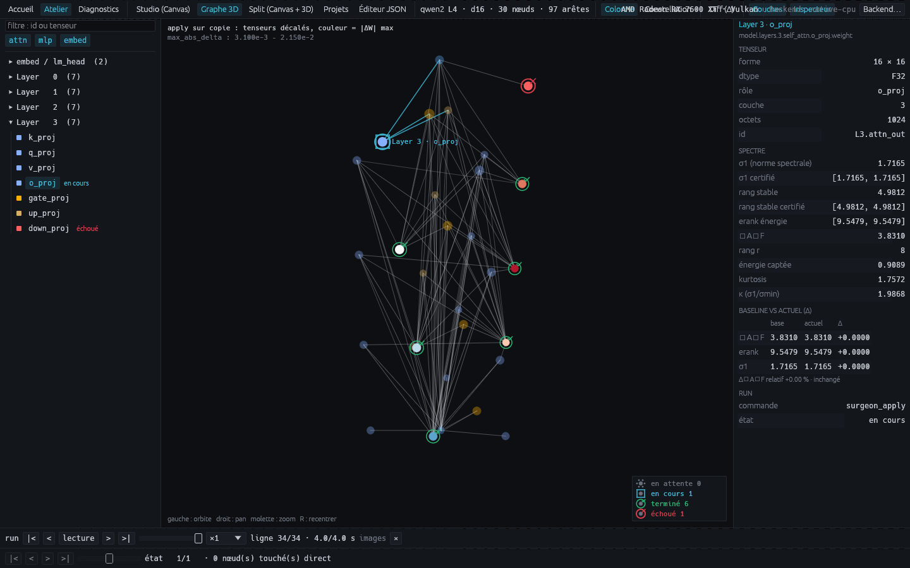
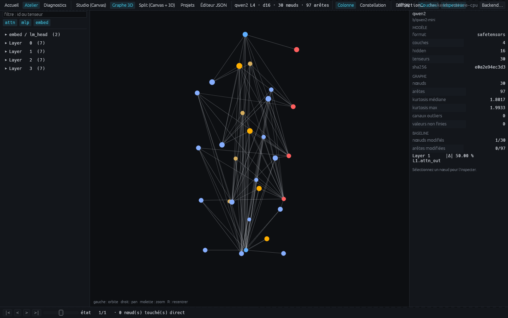

# Vue 3D en direct, rejeu et lanceur d'analyses

Ce que la vue `Graphe 3D` de `crates/surgeon-gui` montre d'un run, comment on le rejoue, et
comment l'espace `Projets` lance une analyse après en avoir estimé le coût. Le socle (projets,
jobs, protocole d'événements `SurgeonEvent`) est décrit dans [STUDIO.md](STUDIO.md).

Code : `crates/surgeon-gui/src/studio/live.rs` (couche d'un run, rejeu),
`studio/estimate.rs` (estimation, contrôle de budget), `viewport.rs` (rendu), `app.rs`
(barre de rejeu, inspecteur, navigation clavier), `studio/view.rs` (lanceur).



## 1. Un run sur le graphe

Un run est un flux de lignes `SurgeonEvent` : en direct depuis un job du studio, ou relu
depuis son `runs/<id>/events.ndjson`. Les deux passent par le même repli (`RunView`), donc
un rejeu arrivé au bout montre exactement ce qui était à l'écran en direct.

- **Correspondance** : un `node_id` est un id de nœud du graphe (`L3.attn_out`) ou un nom
  de tenseur (`model.layers.3.self_attn.o_proj.weight`). `Step.index` résout les deux ; un
  id de graphe l'emporte sur un nom de tenseur égal. Les ids absents du graphe (prompts,
  opérations, autre modèle) sont comptés et affichés (« n id(s) du run hors de ce graphe »).
- **Réduction déterministe** : chaque ligne est appliquée dans l'ordre de `seq`. Une ligne
  déjà vue (doublon) ou plus ancienne que la dernière (désordre) est ignorée et comptée
  (`stale`) : un nœud ne revient jamais à un état antérieur. Une ligne perdue est comptée
  (`gaps`). Le dernier état reçu par nœud fait foi.
- **Source** : le rejeu ouvert s'il y en a un, sinon le run suivi s'il tourne, sinon le
  premier job en cours du projet.

### États : jamais la couleur seule

| État | Glyphe autour du nœud | Couleur | Mot (liste, infobulle, légende) |
| --- | --- | --- | --- |
| `pending` | anneau pointillé (6 points) | gris | en attente |
| `running` | carré | cyan | en cours |
| `done` | anneau et coche | vert | terminé |
| `failed` | anneau épais et croix | rouge | échoué |

La légende (en bas à droite) répète glyphe, mot et compte de chaque état. La liste des
couches écrit l'état en toutes lettres à côté du nœud, l'infobulle (« run : terminé ·
max_abs_delta 1.2e-2 ») et l'inspecteur aussi. Les nœuds qu'un run n'a pas atteints sont
atténués.

### Surcouches par type de job

Le type vient de la commande `job_started` (`surgeon_apply` dans le studio, `apply` ou
`bench eval` avec `surgeon --events`).

| Type | Ce que montrent les nœuds | Couleur de remplissage |
| --- | --- | --- |
| `graph` | matrices analysées (`done` par matrice) | rôle |
| `apply` (sur copie) | tenseurs décalés | `max_abs_delta` (le plus grand \|ΔW\| du tenseur), échelle et palette du rapport (`color_scale`, `palette`, celles des arêtes exportées) |
| `extract` | rien par nœud (avancement par jeu de prompts dans `Projets`) | rôle |
| `bench`, `eval`, `pipeline` | hors graphe : prompts, questions, étapes (comptés « hors de ce graphe ») | rôle |

`max_abs_delta` par tenseur est émis par le moteur depuis cette version (`ProgressEvent::Shift`
porte `max_abs_delta`, `events::from_progress` en fait un `metric`). La plage min – max est
affichée en haut à gauche.

## 2. Rejeu

- Depuis `Projets`, run suivi : `3D` (les nœuds atteints), `Diff Δ` (la même vue en mode Δ),
  `Inspecteur` (le dernier nœud atteint, inspecteur ouvert). Un run terminé est rejoué
  depuis son fichier, un run en cours est suivi en direct. Le graphe écrit par le run
  (`out/graph.json`, sinon `out/graph.ndjson`) est ouvert s'il existe ; sinon le run se
  dessine sur le graphe déjà ouvert.
- En ligne de commande : `surgeon-gui graph.json --replay runs/<id>/events.ndjson`.
- La barre du bas : `|<` début, `<` ligne précédente, `lecture` / `pause`, `>` ligne
  suivante, `>|` fin, curseur sur les lignes, vitesse (×0.25 à ×64, en temps du run par
  seconde réelle), position `ligne k/N · t/T s`, `×` ferme le rejeu.
- Le rejeu s'ouvre à la fin (le résultat d'abord). `lecture` depuis la fin repart du début.
  La lecture suit `t_ms` des lignes : une ligne s'applique quand l'horloge du rejeu l'atteint.
- La position `k` montre le repli des `k` premières lignes, dans un sens comme dans l'autre.

## 3. Inspecteur et clavier

- L'inspecteur donne l'identité complète du tenseur : nom, forme, dtype, rôle, couche,
  expert (MoE), octets, id. Avec un run sur la vue, une section `RUN` ajoute la commande,
  l'état du nœud et chaque métrique que le run a envoyée pour lui (par id ou par nom de
  tenseur).
- Liste des couches : `↓` / `↑` passent au nœud suivant / précédent dans l'ordre affiché
  (filtres compris), en ouvrant sa couche et en le faisant défiler à l'écran ; `Échap`
  désélectionne. Inactif pendant la saisie dans un champ. `R` recentre la caméra.
- Les boutons des barres sont atteignables par `Tab` (egui).

## 4. Lanceur d'analyses

- **Formulaires** : un par outil MCP du moteur, générés depuis son `inputSchema` (test
  `every_form_is_its_engine_schema` : mêmes champs, mêmes requis, mêmes choix).
- **Estimer** : lance le mode aperçu de l'outil comme un run ordinaire (historique, journal,
  annulation) :

  | Outil | Aperçu | Lu dans l'enveloppe |
  | --- | --- | --- |
  | `surgeon_graph` | `estimate: true` | `estimated_seconds`, `bytes_read` |
  | `surgeon_apply` | `dry_run: true` | GGUF : `preflight.estimated_seconds`, `work_bytes` |
  | `surgeon_lora` | `dry_run: true` | (validation seule, pas de durée) |
  | `surgeon_pipeline` | `action: plan` | `estimated_secs`, `disk.total_bytes`, avertissements |

  Les aperçus de graphe, d'apply et de LoRA n'écrivent aucun modèle et passent dans la voie
  légère (à côté d'un job lourd) ; le `plan` de pipeline reste lourd, il peut calibrer.
- **Contrôle de budget avant lancement** : sans `durée max`, rien n'est exigé. Avec une
  `durée max` et un outil qui a un aperçu, `Mettre en file` exige l'estimation de ces
  paramètres exacts (changer un champ la périme) et refuse un run dont l'estimation dépasse
  le budget. Une estimation sans durée (non calibrée) ne bloque pas : le budget arrête
  toujours le run quand il est atteint ([STUDIO.md](STUDIO.md), « Budgets »).
- **Jobs** : `Annuler` (en file ou en cours), `Reprendre` après un arrêt brutal, et le run
  suivi s'ouvre dans la 3D, le Diff Δ ou l'Inspecteur (section 2).

## 5. Performance

Rendu `egui` + `glow` (OpenGL), sans changement de moteur de rendu. Le coût d'une frame
reste plat sur les gros graphes :

- **Élagage des arêtes** : `Step` trie ses arêtes une fois (structurelles d'abord, puis
  |poids| décroissant, tri stable). La vue en dessine un préfixe : 4 000 arêtes, 1 200 au-delà
  de 400 nœuds ; les arêtes structurelles et celles du nœud sélectionné sont toujours là.
  Une arête de moins d'un demi-pixel n'est pas dessinée.
- **Niveaux de détail** : le budget d'arêtes baisse avec le nombre de nœuds ; les rayons
  suivent la profondeur (2,5 à 9 px) ; les étiquettes ne sont dessinées que pour la sélection
  et le survol.
- **Tampons réutilisés** : projections, ordre de profondeur, cibles du picking et formes
  vivent dans `viewport::Buffers` d'une frame à l'autre ; la couche du run (`live::Layer`)
  est remplie en place.
- **Mesure** : `cargo test --release -- --ignored frame_cost` (dans `crates/surgeon-gui`)
  mesure le côté CPU d'une frame (mise en page egui et tessellation, sans l'envoi GPU) sur
  600 nœuds et 2 390 arêtes avec une couche de run : 1,3 ms par frame (release) sur la
  machine de développement, sous les 16,7 ms de 60 i/s.
- **Mémoire bornée en direct** : le canal tient 1 024 lignes, la vue garde une entrée par
  nœud et par (nœud, métrique) et 500 lignes de journal (test sur 200 000 événements).

## 6. Tests (sans GPU)

| Sujet | Test |
| --- | --- |
| Réduction : ordre, doublons, perte | `live::duplicates_reordering_and_losses_never_move_a_node_back` |
| Rejeu : curseur dans les deux sens, lecture au temps du run | `live::the_cursor_shows_the_fold_of_the_lines_before_it_both_ways`, `live::playback_follows_stream_time_and_stops_at_the_end` |
| Coalescence 60 Hz, contre-pression | `bus::the_window_folds_at_most_once_per_frame`, `bus::the_file_keeps_every_line_while_a_lagging_window_samples_progress` |
| Charge haut débit, mémoire bornée | `live::a_high_rate_run_keeps_bounded_memory` |
| Correspondance id / tenseur, surcouche apply, échelle de couleur | `live::the_layer_maps_states_and_deltas_onto_graph_nodes` |
| Disposition et picking déterministes | `viewport::layouts_and_picking_are_deterministic` |
| Glyphes distincts (pas seulement la couleur) | `viewport::every_state_has_its_own_glyph_and_label` |
| Rendu hors écran : vide, 600 nœuds (budget d'arêtes), échec | `viewport::an_empty_graph_renders_its_frame_and_help`, `viewport::five_hundred_nodes_render_within_the_edge_budget`, `viewport::a_failed_run_reads_in_the_legend_and_the_glyphs` |
| Navigation clavier | `app::arrow_keys_walk_the_shown_list_and_stop_at_its_ends` |
| Formulaires == schémas | `forms::every_form_is_its_engine_schema` |
| Estimation avant lancement, budget | `estimate::*`, `jobs::an_estimate_runs_beside_a_heavy_run_but_a_pipeline_plan_waits` |
| Compatibilité `graph.json` / NDJSON / `events.ndjson` v1 | `source::*`, `live::the_v1_fixture_replays`, `tests/desktop.rs` (`--screen graph --replay`) |

## 7. Captures

Rendu hors écran (CPU, sans fenêtre ni GPU), depuis `crates/surgeon-gui` :

```bash
cargo run --release -- --screenshot ../../docs/images/gui-3d-graph.png --screen graph \
  tests/fixtures/qwen2-mini.ndjson
cargo run --release -- --screenshot ../../docs/images/gui-3d-replay.png --screen graph \
  --replay ../../docs/images/gui-3d-replay.ndjson tests/fixtures/qwen2-mini.ndjson
```

`gui-3d-replay.ndjson` est un apply simulé sur ce graphe, écrit à la main au format v1 (six
tenseurs terminés avec leur |ΔW|, un en cours, un en échec).



## 8. Écarts et limites

- **Flux de tokens de génération** : hors périmètre. `surgeon_eval` et `surgeon_bench`
  publient l'avancement par prompt, pas les tokens générés.
- **Énergie retirée** (`project_out`) et ‖ΔW‖ de Frobenius : non calculés par le moteur. La
  surcouche d'apply montre le plus grand |ΔW| élémentaire par tenseur.
- **États émis** : le moteur n'émet que `done` (et `max_abs_delta`) ; `pending`, `running`
  et `failed` sont dessinés quand un producteur les envoie (protocole v1), ce que les tests
  couvrent, mais aucun outil du moteur ne les envoie encore.
- **Rejeu** : toutes les lignes sont gardées en mémoire et un retour en arrière rejoue depuis
  le début ; prévu pour quelques centaines de milliers de lignes.
- **Mesure de 60 i/s** : le côté CPU est mesuré ; l'envoi GPU et le pilote OpenGL ne le
  sont pas (la frame réelle dépend de la carte).
